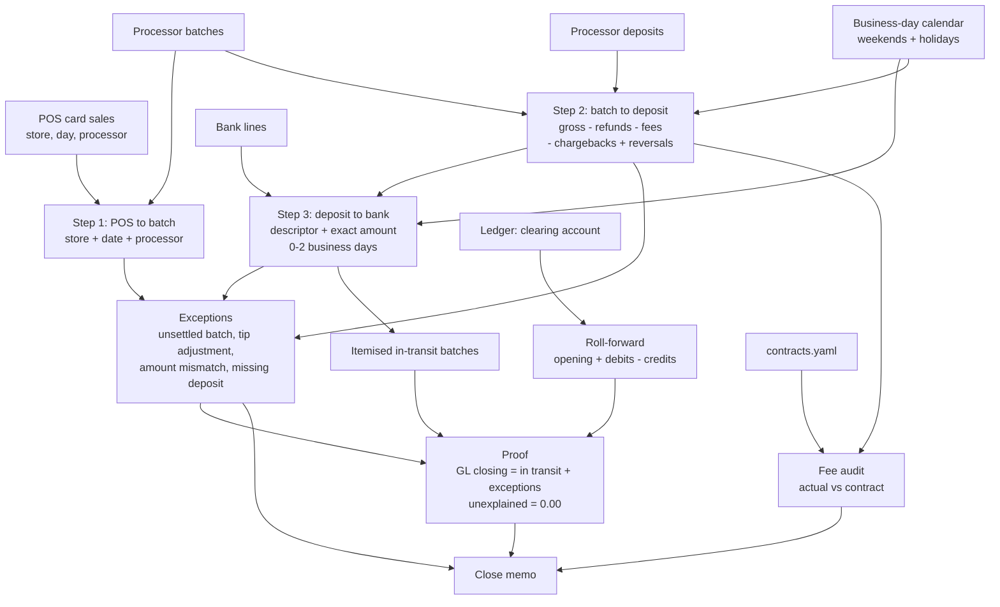

# settlerec

[](https://github.com/SlateGitOrg/settlerec/actions/workflows/ci.yml)


settlerec reconciles card settlements for a multi-store retailer in DuckDB SQL and proves the month-end balance of the card clearing account instead of judging it reasonable. POS card sales, processor batches, processor deposits and bank lines are matched on a business-day calendar, and the ledger balance must equal an itemised list of in-transit batches plus open exceptions, with an unexplained residual of exactly $0.00. Every dollar that does not settle ends up with a store and a date. All data in this repository is synthetic.

## The problem

A 35-store specialty retailer takes most of its sales by card through two processors. The POS records card sales per store per day. The processors batch them, deduct fees and chargebacks, and deposit one lump per processor per day for all stores one to three business days later, so the bank statement shows only a net amount. The card clearing account carries a month-end balance nobody can explain, and a store batch that never settled can sit inside it for months, looking like timing.

The difficulty is the calendar. A Friday batch that is deposited on Tuesday because Monday was a bank holiday is normal; a deposit that never arrived is not, and the two look alike until deposit dates are counted in business days. Fees add a second problem: one processor can quietly charge more than its contract, and the overcharge hides in the same net deposits.

## How it works



The pipeline is seven SQL files in `src/settlerec/sql/`, run in order by `settlerec.runner` on an in-memory DuckDB database. Python loads the nine input files into typed tables and prints results; every join, classification and total is SQL.

| File | Responsibility |
| --- | --- |
| `10_staging.sql` | Typed staging tables, contract terms, the business-day calendar and its macros |
| `20_pos_to_batch.sql` | Key match on store, date and processor; `tip_adjustment`, `amount_mismatch`, `unsettled_batch` |
| `30_batch_to_deposit.sql` | Each deposit must equal batch gross - refunds - fees - chargebacks + reversals; chargeback summary |
| `40_deposit_to_bank.sql` | Descriptor and exact amount, bank date 0-2 business days after the deposit; nearest date wins, exact ties are `ambiguous`, no line is `missing_deposit` |
| `50_clearing.sql` | Monthly roll-forward, the in-transit list and the open exceptions at every month end |
| `60_proof.sql` | GL closing balance - (in transit + open exceptions) = unexplained |
| `70_fee_audit.sql` | Effective fee rate against contract per processor-month, and the overcharge |

The ledger convention the proof rests on: the clearing account is debited from the POS on the sales date and credited, on the bank date, with the gross of the batches in each deposit. Refunds, fees and chargebacks are booked to their own accounts when the deposit is booked, so they never touch clearing. Looking at each POS row as of a month end, exactly one of these holds, and that is what the proof adds up: settled (nets to zero), in transit (bank line after the month end), unsettled batch, missing deposit (window closed, no bank line), or a tip adjustment or amount mismatch (credit differs from debit by the difference).

## Quick start

```bash
python -m venv .venv && source .venv/bin/activate
pip install -e ".[dev]"

settlerec generate --out data                 # synthetic inputs and truth.json
settlerec run --data data --month 2026-06     # proof for every month, roll-forward for one
settlerec exceptions --data data --month 2026-06
settlerec fees --data data
settlerec memo --data data --month 2026-06    # writes out/close-memo-2026-06.md

pytest -q
```

`run` exits with status 1 if any month has a non-zero residual, so it can gate a close. `--db settlerec.duckdb` keeps the database for ad hoc queries against the result tables (`proof`, `open_exceptions`, `in_transit`, `deposit_bank`, `fee_audit`).

The generator is seeded (`--seed`, default 18). It writes `stores.csv`, `pos_daily.csv`, `processor_batches.csv`, `processor_deposits.csv`, `processor_fees_monthly.csv`, `bank.csv`, `gl_clearing.csv`, `calendar.csv`, `contracts.yaml` and `truth.json`. The data covers 2026-01-02 to 2026-06-30: 12,600 POS rows (35 stores, two processors), 12,599 batches and 248 deposits (one per processor per business day). Processor A (Visa, Mastercard, Discover) settles the next business day, deposits the same day and deducts fees from each deposit under a contract of 1.85% + $0.10 per transaction. Processor B (American Express) deposits gross one business day after settlement and debits 2.9% monthly on the third business day. Planted in it, and recorded in `truth.json`:

- store S17's processor A batch for 2026-02-10 is never submitted;
- one processor B deposit (2026-04-14) is reported paid but is absent from the bank;
- 12 chargebacks, 3 of them later reversed;
- processor A charges 1.95% from 2026-04-01 without a contract change;
- two store-days where post-close tips make the batch exceed the POS;
- two processor A deposits of identical amount on consecutive days.

## Example output

`settlerec run --data data --month 2026-06`:

```text
Month    GL closing  In transit  Open exceptions  Unexplained  Status
-------  ----------  ----------  ---------------  -----------  ------
2026-01  359,254.06  359,254.06             0.00         0.00  proved
2026-02  389,860.27  387,664.07         2,196.20         0.00  proved
2026-03  192,628.63  190,695.87         1,932.76         0.00  proved
2026-04  228,367.14  167,668.07        60,699.07         0.00  proved
2026-05  698,605.70  638,489.38        60,116.32         0.00  proved
2026-06  320,748.95  260,632.63        60,116.32         0.00  proved

Roll-forward 2026-06
  Opening balance         698,605.70
  + POS debits          4,866,430.26
  - Bank credits        5,244,287.01
  Closing balance         320,748.95

Proof 2026-06: 320,748.95 = in transit 260,632.63 + open exceptions 60,116.32 + unexplained 0.00  [proved]
```

`settlerec exceptions --data data --month 2026-06`:

```text
Open exceptions at the end of 2026-06: 4
Type             Store  Date           Amount  Effect on clearing  Age (bd)  Reference
---------------  -----  ----------  ---------  ------------------  --------  ------------------
unsettled batch  S17    2026-02-10   2,196.20            2,196.20        97  POS S17 2026-02-10
tip adjustment   S09    2026-03-14     263.44             -263.44        75  A-20260314-S09
missing deposit  all    2026-04-14  58,726.37           58,766.31        53  DEP-B-20260414
tip adjustment   S24    2026-05-09     582.75             -582.75        35  A-20260509-S24
```

`settlerec fees --data data`:

```text
Proc  Month           Gross  Contract eff. rate  Actual eff. rate  Contract fee  Actual fee  Overcharge  Cumulative
----  -------  ------------  ------------------  ----------------  ------------  ----------  ----------  ----------
A     2026-01  3,200,386.87              2.026%            2.026%     64,854.06   64,854.06        0.00        0.00
A     2026-02  3,360,167.12              2.028%            2.028%     68,131.59   68,131.59        0.00        0.00
A     2026-03  4,312,117.30              2.027%            2.027%     87,418.47   87,418.47        0.00        0.00
A     2026-04  4,175,818.53              2.026%            2.126%     84,602.14   88,777.96    4,175.82    4,175.82
A     2026-05  4,463,764.14              2.028%            2.128%     90,515.44   94,979.20    4,463.76    8,639.58
A     2026-06  4,795,892.41              2.026%            2.126%     97,187.21  101,983.10    4,795.89   13,435.47
B     2026-01    344,018.13              2.900%            2.900%      9,976.53    9,976.53        0.00        0.00
B     2026-02    381,044.35              2.900%            2.900%     11,050.29   11,050.29        0.00        0.00
B     2026-03    489,771.32              2.900%            2.900%     14,203.37   14,203.37        0.00        0.00
B     2026-04    473,302.17              2.900%            2.900%     13,725.76   13,725.76        0.00        0.00
B     2026-05    498,252.21              2.900%            2.900%     14,449.31   14,449.31        0.00        0.00
B     2026-06    543,756.91              2.900%            2.900%     15,768.95   15,768.95        0.00        0.00
```

Excerpts from the June 2026 close memo written by `settlerec memo --data data --month 2026-06`:

```markdown
## Roll-forward

| Line | Amount |
| --- | ---: |
| Opening balance (2026-06-01) | 698,605.70 |
| Debits: POS card sales | 4,866,430.26 |
| Credits: processor deposits at the bank | 5,244,287.01 |
| Closing balance (2026-06-30) | 320,748.95 |

## Proof

GL closing balance 320,748.95 = in transit 260,632.63 (140 batches) + open exceptions 60,116.32 (4 items) + unexplained 0.00.

Status: **proved**.

## Open exceptions

| Type | Store | Date | Amount | Effect on clearing | Age (bd) | Reference |
| --- | --- | --- | ---: | ---: | ---: | --- |
| unsettled batch | S17 | 2026-02-10 | 2,196.20 | 2,196.20 | 97 | POS S17 2026-02-10 |
| tip adjustment | S09 | 2026-03-14 | 263.44 | -263.44 | 75 | A-20260314-S09 |
| missing deposit | all | 2026-04-14 | 58,726.37 | 58,766.31 | 53 | DEP-B-20260414 |
| tip adjustment | S24 | 2026-05-09 | 582.75 | -582.75 | 35 | A-20260509-S24 |

## Fee audit

| Proc | Month | Gross | Contract eff. rate | Actual eff. rate | Contract fee | Actual fee | Overcharge | Cumulative |
| --- | --- | ---: | ---: | ---: | ---: | ---: | ---: | ---: |
| A | 2026-06 | 4,795,892.41 | 2.026% | 2.126% | 97,187.21 | 101,983.10 | 4,795.89 | 13,435.47 |
| B | 2026-06 | 543,756.91 | 2.900% | 2.900% | 15,768.95 | 15,768.95 | 0.00 | 0.00 |

Processor A charged 2.126% against 2.026% under contract; cumulative overcharge 13,435.47.

The missing deposit's amount is the net the processor reports paying; its effect on clearing is the gross of the batches it covered. The same four items are open at the end of May, so the exception list is the standing reconciliation, not a monthly surprise.
```

## Design decisions

1. **The matching and the proof are SQL, run as ordered files.** Joins, classification and totals are plain DuckDB SQL that a finance analyst can read and run in a DuckDB shell; Python only loads files and formats output. The cost is that business-day arithmetic lives in SQL macros (`bd_add`, `bd_between`) over a calendar table with a running business-day count, which is less obvious than a Python function; a test compares the macros with an independent Python calendar for every date in the period.
2. **Nearest-date matching in rounds, and ties are flagged rather than guessed.** Each deposit proposes its nearest bank line with the same descriptor and exact amount, each bank line proposes its nearest deposit, and mutual choices are fixed; this repeats on what is left. Two equal deposits on consecutive days therefore pair correctly by date. If two candidates tie for nearest the deposit is marked `ambiguous` and listed, because the cash arrived but the pairing is not knowable from the data. The cost is that rounds are explicit statements in the file rather than a single optimal assignment.
3. **A deposit is missing only after its bank window closes.** Until two business days after the deposit date, an unmatched deposit is in transit, so month end does not report a deposit that is still on its way. The cost is that a truly lost deposit is classified as timing for up to two business days.
4. **The residual is a check, not a plug.** The ledger closing balance comes from `gl_clearing.csv`; the in-transit list and exceptions come from the POS, batch, deposit and bank files. They are computed independently, so a stray ledger entry shows up as unexplained (a test adds a $100.00 entry and expects exactly that). The cost is that the ledger convention above is part of the contract: a ledger that books credits differently needs a different `gl_effect` rule in `50_clearing.sql`.
5. **Tips are recognised by a rule, not a field.** Batches carry no tip column, so a batch that exceeds the POS by no more than the contract's `tip_adjustment_max_pct` (25%) is a tip adjustment; any other difference, including a shortfall or a batch with no POS row, is an amount mismatch. A large over-batch is therefore never silently treated as tips.
6. **Fees are audited by deposit month, with a one-cent tolerance.** Expected fee is rate x batch gross + per-transaction fee x transactions over the batches in the month's deposits; actual is what was deducted (processor A) or debited (processor B). Months within one cent are reported as within contract, since fees are rounded to cents. Attribution by deposit date, not batch date, keeps each processor's deductions and the base they apply to in the same month.

## Testing

```bash
pytest -q
```

The tests run offline on a data set generated into a temporary directory. They cover the acceptance conditions on the seeded data (zero residual at all six month ends, roll-forward closing and chaining, S17's batch open in every later month, the missing deposit's date and amount, the Presidents Day batch matching the Tuesday deposit, chargebacks against `truth.json`, the processor A overcharge at 0.10% of gross within a cent, tip classification, nearest-date matching of the identical deposits); hand-computed fixtures (in-transit timing, tip adjustments before and after banking, amount mismatches, an exact tie, a deposit missing and a bank line outside the window, a stray ledger entry, a deposit that does not foot, fee overcharges for both fee modes); the generator (determinism, shape, size); the CLI; and a sqlglot parse of every SQL file. Two runs over the same data produce identical result tables.

## Project layout

```text
settlerec/
├── src/settlerec/
│   ├── bizdays.py      # holiday list and a Python business-day calendar (generator, tests)
│   ├── generate.py     # seeded synthetic data and truth.json
│   ├── runner.py       # loads inputs into DuckDB, runs sql/ in order, sqlglot pre-parse
│   ├── report.py       # reads result tables, formats text and Markdown tables
│   ├── memo.py         # close memo
│   ├── cli.py          # generate, run, exceptions, fees, memo
│   └── sql/            # 10_staging ... 70_fee_audit
├── tests/              # acceptance, scenarios, generator, SQL, CLI
├── .github/workflows/ci.yml
└── pyproject.toml
```

## License

MIT. See `LICENSE`.
